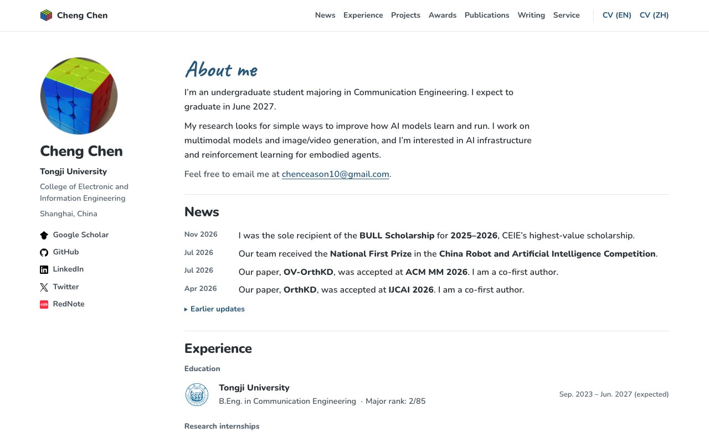

# Cube Page

A single-page academic homepage with a paper list, short news archive and room for projects. The [live edition](https://ceasonen.github.io/cube_page/) uses Cheng Chen’s public academic profile and Rubik’s Cube photograph.



## Run locally

Use Node.js 22 or newer. There are no packages to install.

```sh
npm run build
npm test
python3 -m http.server 8000 --directory dist
```

Open `http://localhost:8000/`. Open `dist/index.html` directly if you only want to preview the built page.

## Make it yours

| Item | Edit |
| --- | --- |
| Profile, email, social links and CV URLs | `content/site.json` |
| News, experience, publication credits, projects and awards | `content/site.json` |
| Writing, talks and reports | Fill the matching arrays in `content/site.json` |
| Portrait, logos, browser icon and paper figures | `public/images/` |
| Type, spacing and visual styles | `public/style.css` |
| HTML structure | `src/render.mjs` |

Dates in the news and writing arrays use `YYYY-MM-DD`. News is displayed in the order given, with the first four entries visible. Empty sections are omitted from the page and navigation. Set the site URL in the content file to the address where your copy is hosted.

The included workflow builds and tests the site before publishing. In a new repository, select **Settings → Pages → GitHub Actions** as the publishing source. The workflow publishes the `dist/` directory and supports a repository subpath.

## Design references

[WowPage](https://github.com/WD7ang/WowPage) by Weidong Tang and Yue Su informed the section structure and the split between content and templates. The visual reference was [Weidong Tang’s homepage](https://wd7ang.github.io/), especially its dated updates, institutional marks and publication thumbnails. [Nielsen Norman Group’s visual hierarchy guidance](https://www.nngroup.com/articles/visual-hierarchy-ux-definition/) informed the type scale and section spacing. The body type retains the original Homepage’s Nunito, with Caveat reserved for the introduction heading. The prose uses a constrained measure following the [W3C guidance on reflow and readability](https://www.w3.org/WAI/WCAG22/Understanding/visual-presentation).

The source code is MIT licensed. Nunito and Caveat are distributed with their [OFL notices](public/fonts/). Replace the profile photograph, paper illustrations, institutional marks and social icons with assets you can use on your own site.
